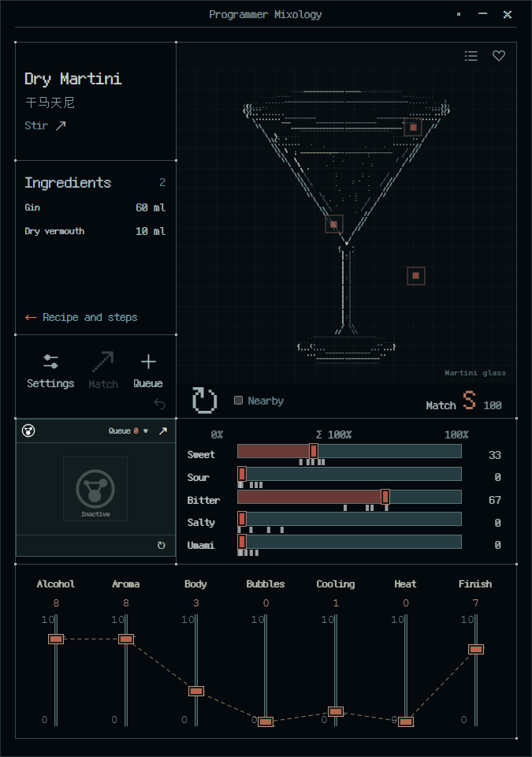

# Programmer Mixology

**程序员调酒台**

<code>LOCAL FIRST</code> · <code>TASTE × RULES × AI</code> · <code>MIT CODE</code>

[中文](README.zh-CN.md) · [User guide](docs/USAGE.md#english) · [Architecture](docs/ARCHITECTURE.md#english) · [Contributing](CONTRIBUTING.md#english)

~~~text
+----------------------------------------------------------+
|  TASTE INPUT  ->  CONSTRAINTS  ->  CANDIDATES  ->  REVIEW  |
|                          ^                         |      |
|                          +---- REAL FEEDBACK ------+      |
+----------------------------------------------------------+
~~~

**Programmer Mixology is a local-first pixel-art cocktail workbench and an open architecture experiment for recipe exploration.** It brings source-linked recipes, five taste preferences, seven sensory dimensions, rule-based generation, an optional local model, and traceable real-world feedback into one workflow.

Cocktails are the first application. The broader goal is to combine AI with explicit ingredient data, nutrition calculations, and human taste feedback to propose, complete, and compare new recipes. The model makes bounded suggestions; deterministic code owns numerical constraints; people prepare and evaluate the result. **The current implementation covers cocktail candidates and a controlled local-model adapter. General food recipes, comprehensive nutrition optimization, and experimentally calibrated taste prediction remain research directions.**

## ▸ The workbench

*The native Windows workbench: character art, five taste controls, and seven sensory axes in a fixed seven-panel layout.*

| Area | Interaction and purpose |
| :--- | :--- |
| Drink name | Chinese and English names, source and revision access |
| Ingredients | Hover to open an external recipe window; click to pin it; inspect steps and estimated serving volume, ABV, and energy |
| Settings and generation | Language, text scale, motion, AI mode, inventory and exclusions, host administration |
| TIMER tag and queue | Add the current drink, import duplicates, reorder, and complete items; access accounts and tickets |
| Five tastes | Sweet, sour, bitter, salty, umami; drag or scroll, double-click to lock, select nearby white preset marks |
| Seven sensory axes | Alcohol heat, aroma, body, carbonation, cooling, spiciness, finish; independent 0–10 sliders |
| ASCII glass | Individual colored character portraits, information hotspots, quotes, random selection; library and favorites at the top right |

New profiles start in **English**. Select 中文 in Settings → General → Language to switch languages. Valid saved language preferences are preserved on upgrade. The desktop workbench uses a fixed layout, **125% default text size**, and full motion by default. Random and preset selection animate sliders toward their new positions; the five displayed integer percentages still total **100% on every frame**.

The library supports custom recipes, duplication, editing, hiding, deletion, and restoration. A .timermix archive stores a complete recipe snapshot, separate user target and prediction, provenance, and a recipe-specific pixel icon. Export surfaces include the library, ASCII glass, TIMER tag, and queue. On Windows, the main workbench supports file clipboard **Ctrl+C / Ctrl+V**. See the [user guide](docs/USAGE.md#english) for behavior and limits.

## ▸ Recipes and Xiaodong's notebook DLC

The bundled catalog contains **396 working drink recipes**: 300 base-library records and **96 recipes in the Xiaodong notebook DLC**. The base library combines IBA reference revisions, community records, and personal notes authorized for this release. These are not 396 officially certified classics or 396 experimentally measured taste profiles.

**Xiaodong created and compiled the notebook.** The DLC preserves its experiences, quotes, and original ingredient descriptions. Missing details are completed through separately identified suggestions and estimates; these additions are not presented as Xiaodong's tested conclusions. The source notebook and authorized material are included with this open-source project. See [third-party and source notices](product/THIRD_PARTY_NOTICES.md) for attribution and rights.

### Authorized source material

- [Xiaodong's original cocktail notebook (DOCX)](product/data/dlc/xiaodong/source.docx): the authored notebook with its original experiences and quotes.
- [Zhenglin Soup original description (TXT)](product/data/personal/zhenglin-soup/source.txt): the complete user-supplied source text.
- [Zhenglin Soup structured recipe (recipe.json)](product/data/personal/zhenglin-soup/recipe.json): source data for development and inspection. This is not a .timermix archive; changing its extension does not make it importable.

These materials are authorized for publication with this project. Actual user databases, accounts, and orders remain private.
The DLC has its own group under **Recipe library → Custom** and is **enabled by default**. Toggle it to include or exclude the group from the workbench, matching, random selection, and presets. Disabling it does not delete its data or separately imported personal copies. Personal databases, accounts, orders, reviews, queues, and runtime credentials are excluded from public source and installer distribution.

## ▸ From cocktails to recipe exploration

The intended research loop is inspectable, replaceable, and reproducible:

1. **Express a preference:** record desired taste, texture, aroma, and exclusions.
2. **Establish ingredient facts:** identify sources, units, actual products, composition, available quantities, and preparation methods.
3. **Propose candidates:** narrow the search with domain rules and let AI assist within permitted choices.
4. **Calculate independently:** compute doses, capacity, nutrition estimates, and constraint violations in code; retain unknowns and assumptions.
5. **Prepare and evaluate:** let people review, make, taste, and record a specific recipe revision.
6. **Calibrate from evidence:** revise predictions using real feedback and compare hypotheses without treating generated scores as measurements.

Current volume, ABV, and energy values are **estimates** derived from source data, category assumptions, and serving conventions. The project does not yet provide a comprehensive macro/micronutrient database, cooking-loss model, personalized nutrition prescription, or sensory-experiment-validated predictor. It does not present alcoholic drinks as a nutrition intervention or provide medical dietary advice. The longer-term architecture can also support nonalcoholic drinks and ordinary foods.

See the [research roadmap](docs/ARCHITECTURE.md#research-roadmap).

## ▸ Invariants

~~~text
sweet + sour + bitter + salty + umami = 10_000 integer bps

user target != recipe prediction != actual tasting review
model output != authority
archive import != guest-menu approval
request retry != another ticket debit
~~~

- Taste business values are integer basis points. The display uses largest-remainder allocation to produce whole percentages. These are preference coordinates, **not ingredient volume percentages**.
- Sensory axes are independent. Alcohol heat is not ABV; cooling is not temperature.
- AI cannot set ingredient doses, calories, permissions, or ticket outcomes. The current model response accepts only a candidate ID and Chinese/English names.
- Generated trials remain pending review and cannot directly become guest-orderable menu entries.
- The host commits ticket debit, inventory changes, an immutable order snapshot, and an outbox event in one transaction. Replaying the same request ID does not debit another ticket.
- Personal state is stored in local SQLite. There is no default administrator password, automatic model download, or automatically enabled LAN listener.

## ▸ Implementation and acceptance boundaries

| Capability | Current state |
| :--- | :--- |
| Windows desktop, seven-panel UI, catalog and personal library | Implemented; consult the release and build report for this version's actual results |
| Taste constraints, sensory matching, rule-based trials | Deterministic implementation with automated tests |
| .timermix, production queue, SQLite persistence | Native implementation; consult release notes for the exact physical cross-window drag-and-drop acceptance scope |
| LAN accounts, TLS, tickets and orders | Service and protocol implementation exists; complete acceptance across two physical devices remains open |
| Controlled llama.cpp adapter | Process management, validation, and fallback implemented; no model is bundled and no real-model performance acceptance is claimed |
| Nutrition and general-recipe optimization | Architectural direction; currently limited to cocktail serving volume, ABV, and energy estimates |
| Android / iOS / macOS | No native artifact validated for this release; responsive UI checks do not establish mobile acceptance |

**1.2.0 is the open-source naming release.** Historical local tests are not proof for a new artifact. Actual commands, passing checks, and unverified areas are recorded in [BUILD_REPORT](product/BUILD_REPORT.md), [STATUS](product/STATUS.md), and the corresponding [GitHub Release](https://github.com/UNKNOWNTIMER/programmer-mixology/releases).

## ▸ Get and run

Repository: **[UNKNOWNTIMER/programmer-mixology](https://github.com/UNKNOWNTIMER/programmer-mixology)**. **Forks, clones, feature branches, and pull requests are welcome.**

Windows users can obtain the actual artifacts and checksums listed under [Releases](https://github.com/UNKNOWNTIMER/programmer-mixology/releases). An explicitly listed .exe is the Windows installer; GitHub's automatically generated Source code ZIP / tar.gz files are source archives. The installer uses current-user installation and requires an existing WebView2 runtime. Check the individual release for signing status.

### Development environment

| Tool | Requirement |
| :--- | :--- |
| Node.js | 24.x; use a lockfile-compatible environment |
| pnpm | 11.25.0, matching the project's selected toolchain |
| Rust | stable; x86_64-pc-windows-msvc on Windows |
| Windows build tools | Visual Studio Build Tools C++ workload and Windows SDK |
| WebView2 | Windows native runtime |
| Python | 3.10+ for reference specifications, data checks, and development scripts only |
| NSIS | Required only for the custom Windows pixel installer |

SQLite is built through the Rust dependencies; no separate database server is required. Model weights and the llama.cpp executable are optional user-supplied files, not basic build dependencies.

Run in **Developer PowerShell for VS** with MSVC configured:

~~~powershell
git clone https://github.com/UNKNOWNTIMER/programmer-mixology.git
cd programmer-mixology

pnpm --dir product/apps/client install --frozen-lockfile
pnpm --dir product/apps/client test
pnpm --dir product/apps/client build
cargo test --workspace --locked --manifest-path product/Cargo.toml

# Start the real Tauri desktop application
pnpm --dir product/apps/client tauri dev
~~~

For browser-only UI development:

~~~powershell
pnpm --dir product/apps/client dev
~~~

Browser mode does not provide native SQLite, Windows file integration, host administration, or local-model processes and is not a substitute for desktop acceptance.

~~~powershell
# Build the Windows release executable
cargo build --release --locked --manifest-path product/Cargo.toml -p pixel-mix

# Build the custom pixel installer after satisfying its tool preflight
./product/scripts/build-windows-installer.ps1

# Separate reference algorithm and seed-data checks
python -m unittest discover -s tests -v
python scripts/validate_seed.py
~~~

The internal pixel-mix crate/executable name and local.pixelmix.workbench app identifier remain unchanged for data and upgrade compatibility. Visible branding is now Programmer Mixology / 程序员调酒台. Older .pixelmix archives remain readable; new exports use .timermix.

## ▸ Repository map

~~~text
programmer-mixology/
|-- product/
|   |-- apps/client/          React + TypeScript + Tauri
|   |-- crates/domain/        Taste, sensory axes, ranking
|   |-- crates/catalog/       Source revisions + SQLite
|   |-- crates/recipe_engine/ Deterministic candidate rules
|   |-- crates/inference/     Controlled llama.cpp adapter
|   |-- crates/lan_host/      Accounts, tickets, orders, TLS
|   |-- scripts/              Build and validation tools
|   |-- tests/                Native / browser test sources
|-- agent/                    Versioned rules and reference agent
|-- reference/                Executable Python specifications
|-- data/                     Sources, predictions, authorized notes
|-- schemas/                  Data contracts
|-- tests/                    Reference tests
|-- docs/                     Bilingual project documentation
~~~

## ▸ License, provenance, and contribution

Original project code and material explicitly authorized for publication under the same terms are available under the [MIT License](LICENSE), permitting use, modification, and distribution, including commercial use, subject to its copyright and permission notice requirements. Author attribution for materials such as Xiaodong's notebook is retained.

**The code license does not replace third-party rights.** Dependencies, fonts, source-linked recipe data, and independent datasets retain their own notices. Citations make preparation facts traceable; they do not establish permission to redistribute an entire source database. Sensory values are editorial predictions, not source-publisher-certified measurements. See [third-party notices](product/THIRD_PARTY_NOTICES.md).

Contributions may include rules, nutrition-data adapters, sensory experiment design, ASCII art, translations, and platform adapters. Start with [CONTRIBUTING](CONTRIBUTING.md#english). A public fork does not grant upstream write access; changes are reviewed through branches and pull requests.

~~~text
[ OWNER: UNKNOWNTIMER ]  [ VERSION: 1.2.0 ]  [ MODE: OPEN SOURCE ]
~~~

Developer: [UNKNOWNTIMER](https://github.com/UNKNOWNTIMER)
