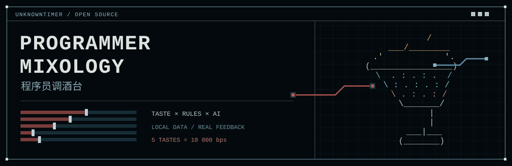
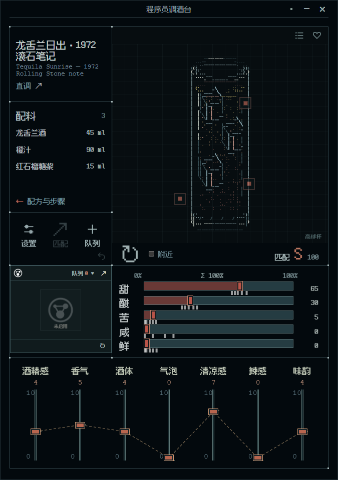
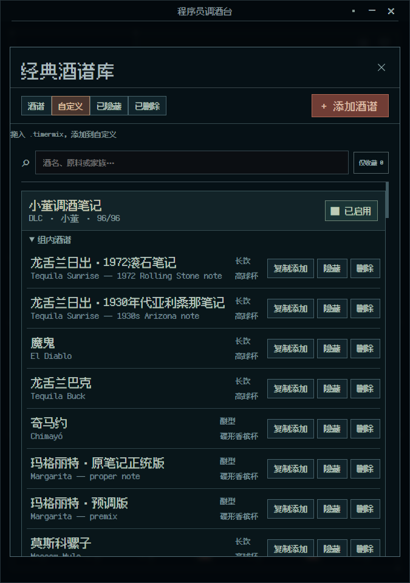
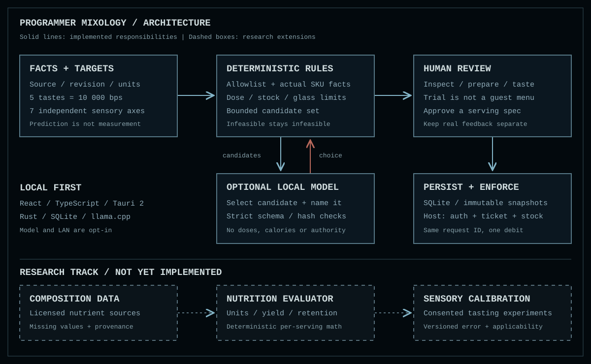

# 程序员调酒台

**Programmer Mixology**

<code>LOCAL FIRST</code> · <code>TASTE × RULES × AI</code> · <code>MIT CODE</code>

[English](README.en.md) · [使用说明](docs/USAGE.md) · [架构与研究方向](docs/ARCHITECTURE.md) · [参与开发](CONTRIBUTING.md)

~~~text
+----------------------------------------------------------+
|  TASTE INPUT  ->  CONSTRAINTS  ->  CANDIDATES  ->  REVIEW  |
|                          ^                         |      |
|                          +---- REAL FEEDBACK ------+      |
+----------------------------------------------------------+
~~~

**程序员调酒台是一款本地优先的像素风调酒工作台，也是面向食谱探索的开放架构实验。** 它把经典酒谱、五味偏好、七维感官、规则生成、可选本地模型和可追溯的实际反馈放在同一个工作流程里。

调酒是第一种应用场景。更长远的目标是让 AI 与明确的原料数据、营养计算和人类味觉反馈协作，提出、补全和比较新的食谱。模型负责受约束的建议，确定性程序负责数值与边界，人负责试作和评价。**当前已实现调酒领域的规则候选与本地模型适配层；通用食谱、完整营养优化和经过实验校准的味觉预测仍是研究方向。**

## ▸ 工作台

*Windows 原生应用工作台。字符杯图、五味与七维控制杆组成固定七区布局。*

| 区域 | 操作与用途 |
| :--- | :--- |
| 酒名 | 中英文名称、来源与版本入口 |
| 配料 | 悬停展开窗口外的配料与步骤，点击固定；查看成杯、酒精度及热量估算 |
| 设置与生成 | 中英文界面、字号与动态效果、AI 模式、库存与排除、主机管理 |
| TIMER 标签与队列 | 把当前酒加入制作队列，重复导入、调整顺序、逐杯完成；进入账户与票据管理 |
| 五味 | 甜、酸、苦、咸、鲜；拖动或滚轮调整，双击锁定，附近白色预设快速切换 |
| 七维感官 | 酒精感、香气、酒体、气泡、清凉感、辣感、味韵；独立的 0–10 分控制杆 |
| ASCII 酒杯 | 逐杯彩色字符画像、资料热点、酒语、随机切换；右上角打开酒谱库与收藏 |

桌面主窗口固定布局，默认字号 **125%**，默认保留完整动态效果。随机或预设切换时，滑块平滑移动；显示的五味整数每一帧仍合计 **100%**。

酒谱库支持自定义添加、复制、编辑、隐藏、删除与恢复。.timermix 文件携带完整酒谱快照、独立目标、配方预测、出处与逐杯像素图标，可从酒谱库、ASCII 杯图、TIMER 标签和队列导出；Windows 文件剪贴板支持主工作台 **Ctrl+C / Ctrl+V**。具体操作和适用边界见[使用说明](docs/USAGE.md)。

## ▸ 酒谱与小董笔记 DLC

内置 **396 杯饮品工作配方**：300 杯基础酒谱，以及 **96 杯小董调酒笔记 DLC**。基础库包含 IBA 参考版本、社区来源记录和经授权公开的个人笔记；它们不是 396 杯经官方认证的经典，也不是 396 份实测味觉数据。

**小董是这份调酒笔记的制作与归纳者。** DLC 保留其体验、酒语和原始材料记述；缺少的信息由独立的建议版本和估算补全，不能把补全内容归为小董的实作结论。原稿和授权材料随本次开源项目一并提供，出处和权利范围见[第三方与资料声明](product/THIRD_PARTY_NOTICES.md)。

DLC 在“经典酒谱库 → 自定义”中单独分组，**默认启用**。点击开关可让整组退出或重新进入工作台、匹配、随机和预设；关闭不会删除资料，也不会删除另行导入的个人副本。个人数据库、账号、订单、评价、队列和运行凭据不随源码或安装包公开。

## ▸ 从调酒走向食谱探索

这个项目希望逐步形成可检查、可替换、可复现的实验流程：

1. **表达偏好**：记录想达到的味觉、质感、香气与限制条件。
2. **建立原料事实**：明确来源、单位、实际品牌、营养成分、可用量与处理方式。
3. **提出候选**：用领域规则缩小范围，让 AI 在允许的候选与表达空间里协作。
4. **独立计算**：由程序计算剂量、容量、营养估计和约束违反情况，保留缺失值与假设。
5. **真实试作**：人确认、制作、品尝，记录配方版本及结果。
6. **逐步校准**：用真实反馈修正预测，比较不同假设，而不是把生成的分数当作事实。

目前的热量和酒精度显示是基于来源数据、类别假设与份量约定的**估算**。项目尚无完整的宏量／微量营养数据库、烹饪损耗模型、个体营养处方或经过感官实验验证的预测器。它不把酒精饮品描述成营养改善方案，也不提供医疗饮食建议。未来架构同样可以用于无酒精饮品和普通食物。

详见[架构文档中的扩展路线](docs/ARCHITECTURE.md#research-roadmap)。

## ▸ 几条始终成立的规则

~~~text
sweet + sour + bitter + salty + umami = 10_000 integer bps

user target != recipe prediction != actual tasting review
model output != authority
archive import != guest-menu approval
request retry != another ticket debit
~~~

- 五味业务数据使用整数基点，显示层用最大余数法分配整数百分比。五味是偏好坐标，**不是配料体积百分比**。
- 七维独立，不归一；“酒精感”不等于 ABV，“清凉感”不等于温度。
- AI 不决定原料剂量、热量、账户权限或扣票结果。当前模型输出只允许候选 ID 与中英文名字。
- 规则／AI 试调默认待审核，不能直接成为客人可点菜单。
- 主机以一个事务保存扣票、库存变化、不可变订单快照和 outbox 事件；相同请求 ID 重试不会重复扣票。
- 个人数据保存在本机 SQLite。没有默认管理员密码，不自动下载模型，不自动开启局域网服务。

## ▸ 当前能力与验证边界

| 能力 | 当前状态 |
| :--- | :--- |
| Windows 桌面、七区像素 UI、酒谱与个人库 | 已有实现；本次版本的实际构建结果见发布页与构建报告 |
| 五味约束、七维匹配、规则试调 | 已有确定性实现与自动化测试 |
| .timermix、制作队列、SQLite 持久化 | 已有原生实现；物理跨窗口拖放仍需按发布说明核对验收范围 |
| 局域网账户、TLS、票据与订单 | 已有服务与协议实现；两台物理设备的完整流程尚未完成验收 |
| 受控 llama.cpp 适配层 | 已有进程管理、校验与回退；未随项目提供模型或宣称完成真实模型性能验收 |
| 营养学与通用食谱优化 | 架构扩展方向；目前仅有调酒领域的成杯、ABV 与热量估算 |
| Android / iOS / macOS | 尚无本次发布验证过的原生安装产物；响应式界面不等于移动应用验收 |

**1.2.0 是本次开源命名版本。** 历史本机测试记录不能替代当前发布物验收；实际命令、通过项与未验证项以 [BUILD_REPORT](product/BUILD_REPORT.md)、[STATUS](product/STATUS.md) 和对应 [GitHub Release](https://github.com/UNKNOWNTIMER/programmer-mixology/releases) 为准。

## ▸ 获取与运行

仓库：**[UNKNOWNTIMER/programmer-mixology](https://github.com/UNKNOWNTIMER/programmer-mixology)**。欢迎 **Fork、拉取代码、创建分支并提交 Pull Request**。

Windows 用户可以从 [Releases](https://github.com/UNKNOWNTIMER/programmer-mixology/releases) 获取该版本实际列出的安装产物及校验值。只把 Release 中明确列出的 .exe 视为 Windows 安装包；GitHub 自动生成的 Source code ZIP / tar.gz 是源码。安装器为当前用户模式，需已有 WebView2；签名状态以该版本说明为准。

### 开发环境

| 工具 | 要求 |
| :--- | :--- |
| Node.js | 24.x；使用与锁文件兼容的环境 |
| pnpm | 11.25.0，与本项目选定工具链一致 |
| Rust | stable，Windows 使用 x86_64-pc-windows-msvc |
| Windows 构建工具 | Visual Studio Build Tools 的 C++ 工作负载与 Windows SDK |
| WebView2 | Windows 原生运行时 |
| Python | 3.10+，只用于参考算法、数据检查及开发脚本 |
| NSIS | 仅在构建定制 Windows 像素安装器时需要 |

SQLite 随 Rust 依赖构建；不需要单独部署数据库服务。模型权重和 llama.cpp 可执行文件由使用者自行准备，不属于基础构建依赖。

在已配置 MSVC 的 **Developer PowerShell for VS** 中执行：

~~~powershell
git clone https://github.com/UNKNOWNTIMER/programmer-mixology.git
cd programmer-mixology

pnpm --dir product/apps/client install --frozen-lockfile
pnpm --dir product/apps/client test
pnpm --dir product/apps/client build
cargo test --workspace --locked --manifest-path product/Cargo.toml

# 启动真实 Tauri 桌面应用
pnpm --dir product/apps/client tauri dev
~~~

仅查看浏览器 UI：

~~~powershell
pnpm --dir product/apps/client dev
~~~

浏览器模式不提供原生 SQLite、Windows 文件接口、主机管理或本地模型进程，不能替代桌面验收。

~~~powershell
# 构建 Windows release 可执行程序
cargo build --release --locked --manifest-path product/Cargo.toml -p pixel-mix

# 构建定制像素安装器（需满足脚本检查的本机工具要求）
./product/scripts/build-windows-installer.ps1

# 独立的参考算法与数据检查
python -m unittest discover -s tests -v
python scripts/validate_seed.py
~~~

内部 pixel-mix crate／可执行文件名及 local.pixelmix.workbench 应用标识继续保留，以兼容既有数据和升级；界面品牌已改为“程序员调酒台”。旧 .pixelmix 存档仍可读取，新输出使用 .timermix。

## ▸ 项目结构

~~~text
programmer-mixology/
|-- product/
|   |-- apps/client/          React + TypeScript + Tauri
|   |-- crates/domain/        Taste, sensory axes, ranking
|   |-- crates/catalog/       Source revisions + SQLite
|   |-- crates/recipe_engine/ Deterministic candidate rules
|   |-- crates/inference/     Controlled llama.cpp adapter
|   |-- crates/lan_host/      Accounts, tickets, orders, TLS
|   |-- scripts/              Build and validation tools
|   |-- tests/                Native / browser test sources
|-- agent/                    Versioned rules and reference agent
|-- reference/                Executable Python specifications
|-- data/                     Sources, predictions, authorized notes
|-- schemas/                  Data contracts
|-- tests/                    Reference tests
|-- docs/                     Bilingual project documentation
~~~

## ▸ 许可证、来源与参与

项目原创代码及明确授权以同一协议发布的材料按 [MIT License](LICENSE) 开放，允许使用、修改和分发，包括商业用途；应保留许可证规定的版权与许可声明。小董笔记等材料的作者归属继续保留。

**代码许可不替代第三方材料的许可。** 依赖、字体、来源酒谱和独立数据集遵循各自的权利声明。来源链接用于追溯制作事实，不代表获得整站内容的再分发授权；感官数值是编辑性预测，不是来源机构认证的分数。详见 [第三方声明](product/THIRD_PARTY_NOTICES.md)。

欢迎贡献新规则、营养数据适配器、感官实验设计、ASCII 美术、翻译与平台适配，从 [CONTRIBUTING](CONTRIBUTING.md) 开始。公共 Fork 不自动获得上游写权限；变更通过分支与 PR 审阅进入项目。

~~~text
[ OWNER: UNKNOWNTIMER ]  [ VERSION: 1.2.0 ]  [ MODE: OPEN SOURCE ]
~~~

开发者：[UNKNOWNTIMER](https://github.com/UNKNOWNTIMER)
